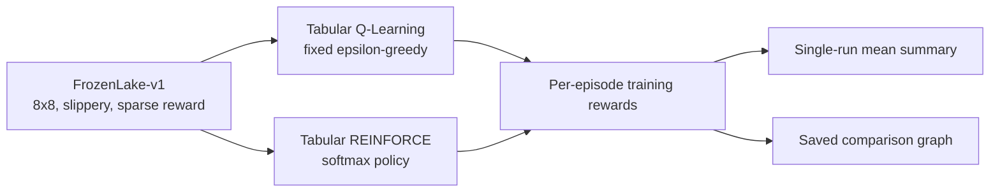
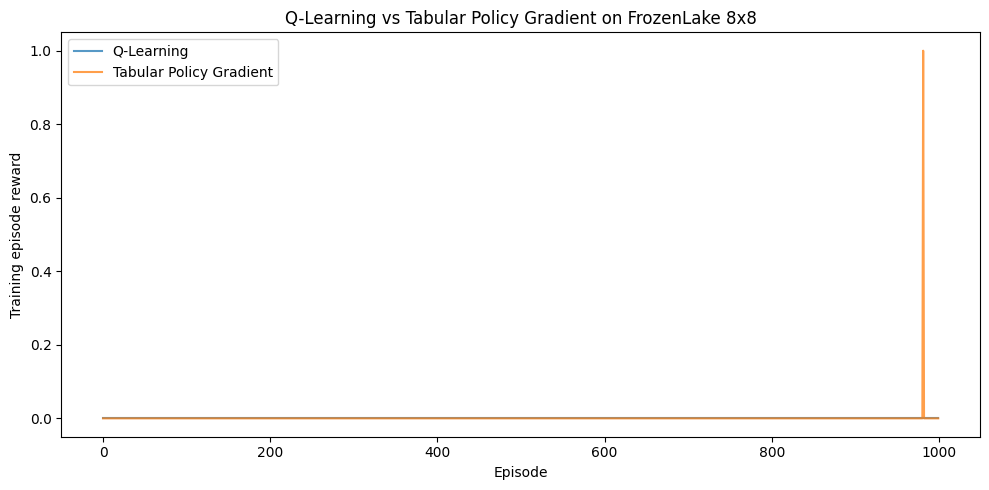

# Q-Learning vs Policy Gradient on Stochastic FrozenLake

An individual reinforcement-learning project comparing tabular Q-Learning with tabular REINFORCE in Gymnasium's stochastic FrozenLake environment. The repository contains the two agent implementations, a saved Colab comparison run, its plot, and lightweight checks. It does not introduce neural networks or additional algorithms.

## Objective

Compare how a value-based tabular method and a policy-based tabular method interact with the same slippery, sparse-reward environment. The available run is a single stochastic training run; it is a project result, not a repeated-seed benchmark.

## At a glance

| Item | Configuration |
|---|---|
| Environment | `FrozenLake-v1`, `map_name="8x8"`, `is_slippery=True` |
| Reward | Gymnasium's default sparse reward: 1 at the goal, 0 otherwise |
| Training | 1,000 episodes per agent |
| Q-Learning | `alpha=0.1`, `gamma=0.99`, fixed `epsilon=0.1` |
| Tabular REINFORCE | `learning_rate=0.01`, `gamma=0.99` |
| Recorded means | Q-Learning `0.0000`; REINFORCE `0.0010` |

## Environment and workflow

The agent observes one of the 64 grid states and chooses one of four actions. With slippery transitions enabled, the action may move the agent in an unintended direction. Each episode ends on a natural terminal state or the environment's time limit.



See [the methodology](docs/methodology.md) for update details and [the experiment report](docs/experiment_report.md) for the recorded run and its limitations.

## Methods

**Q-Learning** stores a value for each state-action pair and applies the one-step Bellman update. It uses fixed-epsilon exploration. True terminal transitions do not bootstrap; an external truncation ends the episode but bootstraps from the final observation.

**Tabular Policy Gradient (REINFORCE)** represents each state's action probabilities with a softmax over state-action logits. It calculates discounted returns and applies the score-function gradient after naturally terminated episodes. Truncated episodes are recorded but excluded from updates because their trajectories are incomplete. This implementation has no value-function critic.

## Recorded results

The saved Colab output reports these mean **training** rewards from one stochastic run:

| Algorithm | Mean training reward |
|---|---:|
| Q-Learning | 0.0000 |
| Tabular Policy Gradient (REINFORCE) | 0.0010 |



The plot was extracted from the saved notebook output; training was not rerun to create it. Machine-readable configuration and values are in [`results/metrics/training_summary.csv`](results/metrics/training_summary.csv). The observations are very low and do not establish that either method is generally better. No independent evaluation is represented by these values.

## Installation and execution

From the repository root, install the listed dependencies and open the saved comparison notebook:

```bash
python -m venv .venv
# Windows: .venv\Scripts\activate
# macOS/Linux: source .venv/bin/activate
python -m pip install -r requirements.txt
jupyter notebook notebooks/frozenlake_comparison.ipynb
```

The notebook contains the 1,000-episode training cell. Run it only when you intend to conduct a new stochastic run; its saved outputs document the existing Colab run.

## Testing and validation

The lightweight `unittest` suite uses small fake environments and does not run the full experiment:

```bash
python -m unittest discover -s tests -v
python -m compileall -q q_learning.py policy_gradient.py tests
```

The notebook integrity test parses its JSON and compiles code cells without executing them. GitHub Actions runs these checks and does not train the agents.

## Repository structure

```text
.
├── .github/workflows/ci.yml
├── docs/
│   ├── experiment_report.md
│   └── methodology.md
├── notebooks/frozenlake_comparison.ipynb
├── results/
│   ├── figures/training_comparison.png
│   └── metrics/training_summary.csv
├── tests/
│   ├── test_agents.py
│   └── test_notebook_integrity.py
├── q_learning.py
├── policy_gradient.py
├── requirements.txt
└── CITATION.cff
```

`original_resources/` contains preserved source material and is kept locally, outside the published repository. The individual software maintainer is **Chegu Bhargav Srikar**. This software citation is distinct from the group authorship of the original research paper; see [`CITATION.cff`](CITATION.cff).

## Limitations and findings

- The reported values come from one stochastic Colab run; no seed or repeated-run distribution is recorded.
- The metric is mean training reward, not a separate policy evaluation. No success rate or independent test result is recorded here.
- Rewards near zero indicate that these observations show little goal-reaching reward during the run; they do not support a general ranking of the algorithms.
- The original paper documents contain conflicting configurations and results that are not corroborated by this notebook output. They are not used as verified metrics.
- The original hyperparameter-tuning attempts did not complete successfully; no successful tuning result is claimed.
- A 10-episode Gymnasium smoke test was reported as passing in Colab. It is a compatibility check, not evidence of learning performance.
